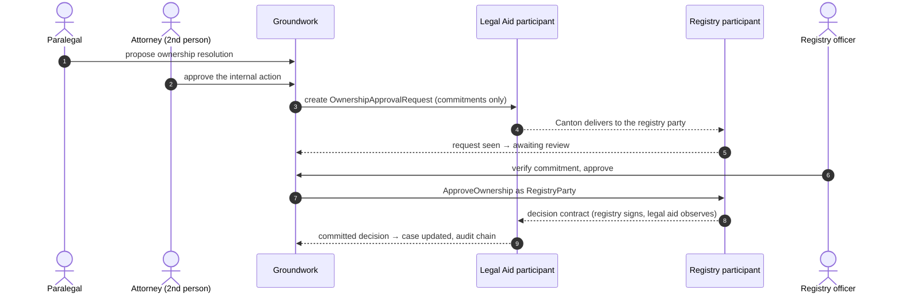
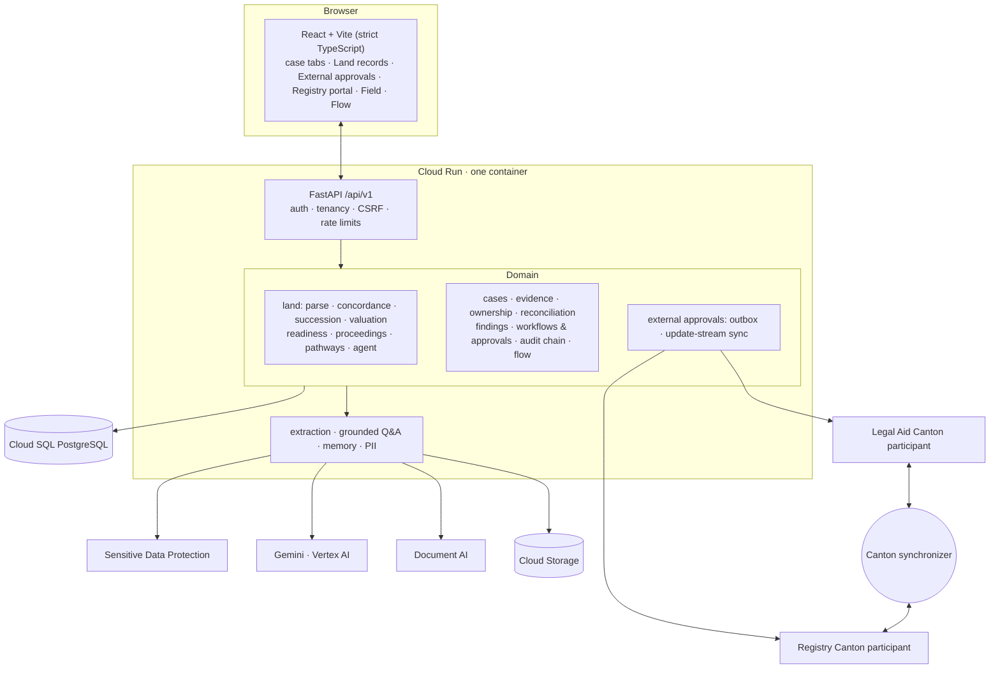

<div align="center">

# 🌾 Groundwork

### Land that families can sell, inherit and borrow against — resolved on the evidence.

**An AI-assisted case platform for land whose records nobody can read: a patta still in a grandfather's name, an FMB sketch that disagrees on the extent, an encumbrance certificate with an open agreement of sale, five heirs of whom two live in the city — and a bank branch that will not look at any of it.**

Built by **[vsrupeshkumar](https://github.com/vsrupeshkumar)** for the **Google Startup Buildathon 2026**


[Problem](#-the-problem) · [What it does](#-what-groundwork-does) · [A case, step by step](#-a-land-case-step-by-step) · [Canton approvals](#-multi-party-approvals-on-canton) · [Architecture](#%EF%B8%8F-architecture) · [Run it](#-run-it-locally) · [Docs](#-documentation)

</div>

---

## 🧭 The problem

For most farming households, land is the main asset — and the least usable one.

- **The record is wrong.** Land passes down without formal partition; the record of rights still shows a parent who died years ago, so nobody can sell, divide or pledge it cleanly.
- **The picture is scattered.** The village accountant, the taluk office, the survey office, the Sub-Registrar, the document writer and the lawyer each hold one piece, and families pay to have their own records read to them.
- **Nobody trusts the value.** Comparable sales are few and under-declared, so banks lend against crops or gold instead — and families turn to moneylenders.
- **Disputes run for years** because the records disagree on names, extents and boundaries, and co-heirs who left the village are never asked.

Groundwork prepares the case. **Ownership decisions stay with revenue authorities and courts, and every valuation carries a stated range and confidence.**

## 💡 What Groundwork does

| | Capability | What it means for the family |
|---|---|---|
| 📜 | **Reads the records** | Patta/chitta, adangal, FMB sketch, EC, sale deeds, death and legal heir certificates — read from uploads with the page each fact came from |
| 🔀 | **Shows where they disagree** | Names (matched across Tamil, Devanagari, Kannada and six more scripts), extents (cents, guntas, hectare-are, bigha, and the measured shape), survey subdivisions, land class and boundaries — each difference names **the office that corrects it** |
| 🧭 | **Checks boundaries both ways** | If our record puts S.No. 124 to the east, S.No. 124's own record must put us to its west |
| 👪 | **Works out draft shares** | Exact fractions through every death since the record was last changed (Hindu Succession Act incl. coparcenary and s.15(2); Indian Succession Act). Muslim law is declined, not guessed |
| 📱 | **Reaches co-heirs who left** | Single-use links on WhatsApp/SMS in the family's language; an online "yes" is intent, a signed letter is consent |
| 🏛️ | **Tracks the office files** | Legal heir certificate, mutation, EC, survey: dated office events, objection windows, indicative service timelines, overdue/stalled detection, and drafted escalations up the chain |
| 🛤️ | **Compares the family's options** | Joint mutation · release to the heir who farms it · partition and subdivision · a collateral-free crop loan now — days, fees, stamp duty, signatures and borrowing power per heir |
| 💹 | **Values the land carefully** | P10–P50–P90 with confidence; guideline-value deeds treated as floors; the lending value is the 20th percentile less a title haircut |
| 🏦 | **Gets it lender-ready** | Each lender's checklist, what the local branch asks for, and a critical-path fix plan with offices, documents, fees and days |
| 🛂 | **Issues a land credit passport** | A two-person-approved, SHA-256-anchored dossier a branch can verify without seeing names |
| 🤝 | **Takes approvals to the registry** | An ownership-resolution proposal decided by the registry's own Canton participant — see below |
| 🗣️ | **Explains it in their language** | The family's own records explained in Tamil, Hindi or English, for free |
| 💸 | **Follows the money** | Rupees and days spent, unreceipted payments, excess over official fees, and the premium paid to moneylenders |
| 🔎 | **Learns from the field** | Six field questions answered from village visits *and* from the cases, side by side |
| 🤖 | **Runs as an agent** | Reads, compares, computes, drafts the applications, watches their deadlines — audited as AI, hands off what only people can do, proposes and never executes |

The same platform still handles **US heirs'-property cases** (deeds, wills, tax bills, ownership chain, financial reconciliation): each case has a *kind*, and a land case gets its own lifecycle, graph and screens.

## 🚶 A land case, step by step


Every gate is computed from the case's own records — never ticked by hand.

1. **Plot and family.** The paralegal enters the survey number, village and taluk, and the family tree: who died, when, spouses and children, who lives away.
2. **Records gathered.** Upload the patta, adangal, FMB sketch and EC. Groundwork reads them into land records, each tied to its document and page; sale deeds of nearby plots become comparable sales.
3. **Records reconciled.** The concordance matrix lays the records side by side. Every difference becomes a finding with the office that corrects it — a deceased holder, a 12.5% extent gap, a one-sided boundary, an open agreement of sale.
4. **Heirs and shares.** Draft shares through every death, step by step in plain words, with the assumptions stated.
5. **Co-heir consent.** Consent links for heirs who left; signed letters recorded against the documents.
6. **Mutation recorded.** The agent drafts the legal heir certificate and mutation applications; each office file is tracked to its order, and an overdue one gets a drafted escalation.
7. **Lender-ready.** Valuation range, lender checklist, fix plan — or a collateral-free crop loan while the title is fixed. The land credit passport is issued after a second person approves.
8. **Verified history.** Every action is on a per-organisation hash chain; closing the case is a two-person action.

## 🤝 Multi-party approvals on Canton

Some decisions belong to **another institution**. Groundwork sends an ownership-resolution proposal to the land registry as a DAML contract on Canton Network.



- **The ledger enforces the rules.** Only the registry can decide; a decision consumes the request; expiry is checked against ledger time; the registry must echo the evidence commitment it reviewed. A forged Legal-Aid-signed approval was refused by Canton with `DAML_AUTHORIZATION_ERROR`.
- **Each organisation has its own participant, party and credentials.** A Legal Aid token is rejected by the Registry participant.
- **Nothing sensitive goes on the ledger** — only opaque ids, salted SHA-256 evidence commitments and decision codes. The registry recomputes the commitment from evidence shared off-ledger before it may approve.
- **Only committed decisions count.** An outbox delivers commands with deduplicated ids; each participant's update stream is read from a saved offset; a status changes only when the Legal Aid participant sees the decision. Outages, resets and stale contracts never become approvals.
- **The internal two-person rule still applies** before anything leaves Groundwork.

**Status:** verified end to end on a real two-participant Canton 3.4 LocalNet. DevNet and TestNet are prepared but **not yet deployed** — they need allowlisting and a sponsor ([docs/canton](docs/canton/architecture.md)).

## 🏗️ Architecture



| Layer | Where |
|---|---|
| Rural land engines | `backend/app/domain/land/` |
| Canton client and approvals | `backend/app/infrastructure/canton/`, `backend/app/domain/external_approvals/` |
| DAML contracts and tests | `contracts/groundwork-approvals/`, `contracts/groundwork-approvals-test/` |
| LocalNet, DevNet, TestNet profiles | `infra/canton/` |
| Core platform (cases, evidence, findings, approvals, audit, flow) | `backend/app/domain/`, `backend/app/services/` |
| Frontend | `frontend/src/features/` (`land`, `external`, `cases`, `flow`, …) |

Canton decides cross-organisation approvals; PostgreSQL is Groundwork's database and read projection; Cloud Storage keeps the original documents; Gemini assists with evidence.

## 🔐 Security by design

- **Tenant isolation:** another organisation's id returns 404, never 403.
- **Two-person rule:** proposer ≠ approver, exact confirmation phrase, single use, expiry, kill switch.
- **Evidence integrity:** SHA-256 on upload, write-once storage, corrections never overwrite originals.
- **Tamper-evident history:** a per-organisation SHA-256 hash chain; `verify` names the exact broken record.
- **AI guardrails:** case-scoped retrieval, PII redaction before prompts, citations checked, agent proposes but never executes.
- **Public pages are narrow:** consent links are single-use, hashed and expiring; passport verification shows no names.
- **Canton:** one credential per participant, OIDC in production, HMAC only on LocalNet, production refuses unsafe settings.

## 🚀 Run it locally

Python 3.12+ and Node 20. Every cloud integration has a local mode.

```bash
cd backend && python -m venv .venv && .venv/bin/pip install -e ".[dev,postgres,gcp]"
.venv/bin/alembic upgrade head && .venv/bin/python -m uvicorn app.main:app --reload --port 8000
```

```bash
cd frontend && npm install && npm run dev        # http://localhost:5173
```

```bash
backend/.venv/bin/python scripts/seed_demo.py    # sign in as pat / demo-password-1
```

Open the **Ramasamy heirs — S.No. 123/4A, Keezhaiyur** case → **Land records**: an overdue legal heir certificate, an issued EC, one signed and one online consent, a co-heir asking for more information. Press **Agent → Prepare this case**.

**With Canton (LocalNet):** `infra/canton/localnet/up.sh`, then `source <(infra/canton/localnet/groundwork.env.sh)` before starting the backend, and `python scripts/canton_demo.py` — full steps in [setup-localnet.md](docs/canton/setup-localnet.md).

## 🧪 Tests

```bash
cd backend && .venv/bin/ruff check app tests && .venv/bin/python -m pytest -q
GROUNDWORK_CANTON_LIVE=1 .venv/bin/python -m pytest tests/canton_live -v        # against a running LocalNet
cd ../frontend && npm run build
python scripts/smoke_e2e.py --base-url http://127.0.0.1:8000                      # 12-step end-to-end
```

DAML: `docker run --rm -v "$PWD/contracts":/work -w /work digitalasset/daml-sdk:3.4.0-rc2 sh -c 'export PATH=/home/daml/.daml/bin:$PATH; daml build --all && cd groundwork-approvals-test && daml test'`

## ☁️ Deploy to Google Cloud

```bash
./infra/scripts/bootstrap.ps1 -ProjectId <PROJECT_ID> -CreateBillableResources
gcloud builds submit --config infra/cloudbuild.yaml --substitutions "_INSTANCE=<PROJECT_ID>:us-central1:groundwork-pg,SHORT_SHA=$(git rev-parse --short HEAD)"
```

Cloud Build runs lint, backend tests, the DAML build and tests, and the frontend build before deploying to Cloud Run. Canton is off unless configured: [deploy-devnet.md](docs/canton/deploy-devnet.md). Runbook: [gcp-runbook.md](docs/deployment/gcp-runbook.md).

## 📚 Documentation

| Doc | About |
|---|---|
| [`docs/land/rural-india.md`](docs/land/rural-india.md) | Rural land records: the brief, the workflow and the field questions mapped to features |
| [`docs/canton/architecture.md`](docs/canton/architecture.md) | Canton approvals: why, participants, contracts, sync, privacy |
| [`docs/canton/setup-localnet.md`](docs/canton/setup-localnet.md) · [`deploy-devnet.md`](docs/canton/deploy-devnet.md) · [`deploy-testnet.md`](docs/canton/deploy-testnet.md) | Running and deploying the Canton integration |
| [`docs/canton/security.md`](docs/canton/security.md) · [`troubleshooting.md`](docs/canton/troubleshooting.md) | Canton security model and common errors |
| [`docs/architecture/overview.md`](docs/architecture/overview.md) | Modules and boundaries |
| [`docs/workflows/case-lifecycle.md`](docs/workflows/case-lifecycle.md) | The heirs'-property case lifecycle |
| [`docs/security/model.md`](docs/security/model.md) | Threat model and controls |
| [`docs/deployment/gcp-runbook.md`](docs/deployment/gcp-runbook.md) | Google Cloud deployment |

---

<div align="center">

**Groundwork** · built by [vsrupeshkumar](https://github.com/vsrupeshkumar) for the **Google Startup Buildathon 2026**

*Every fact traced to a page. Every decision made by a person. Every step on the record.*

</div>
