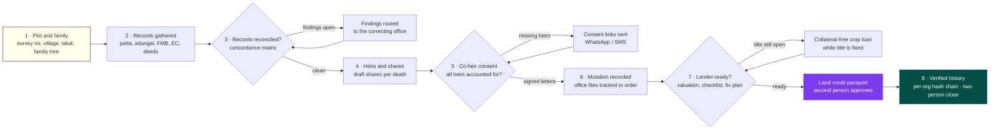
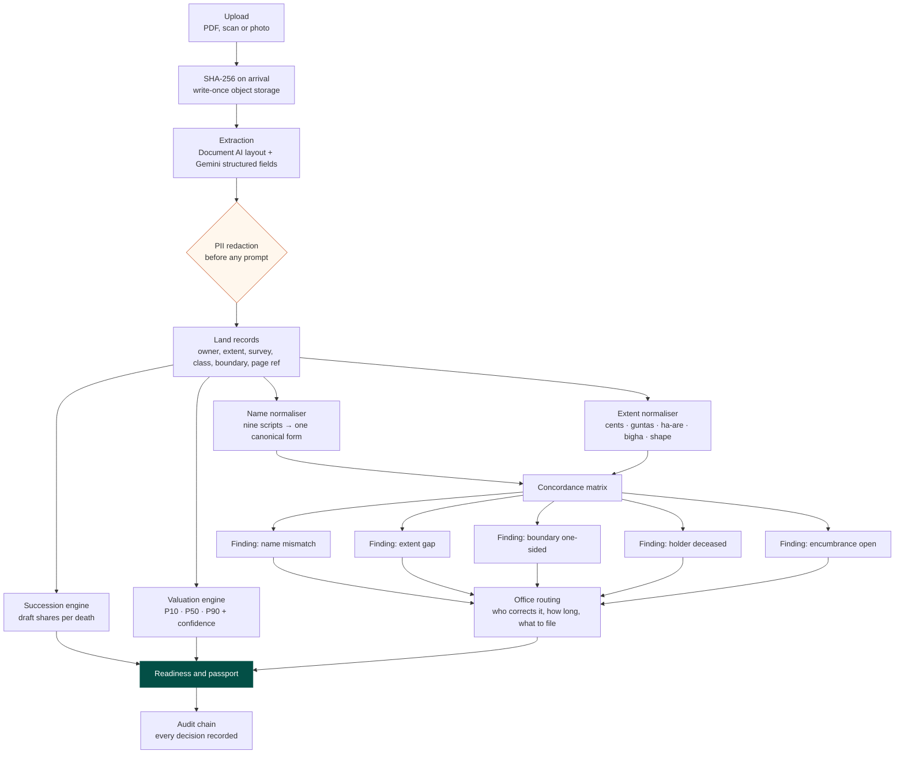
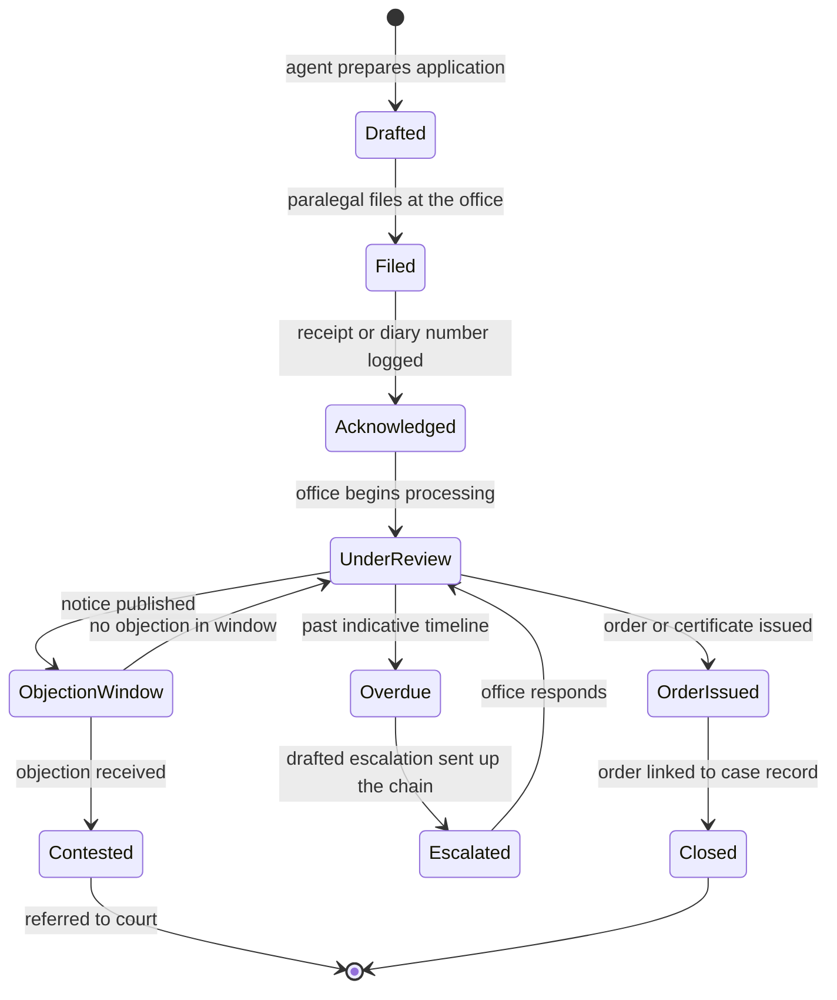
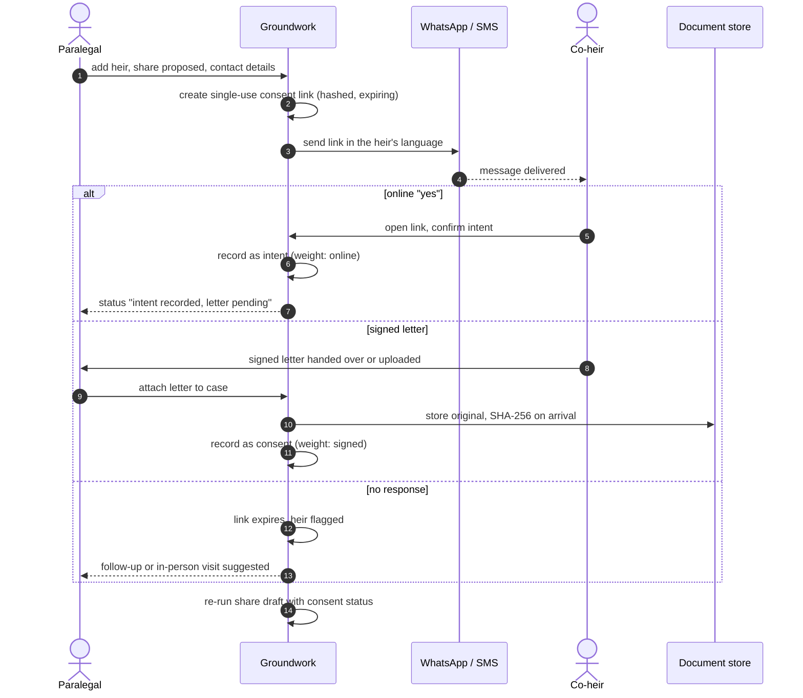
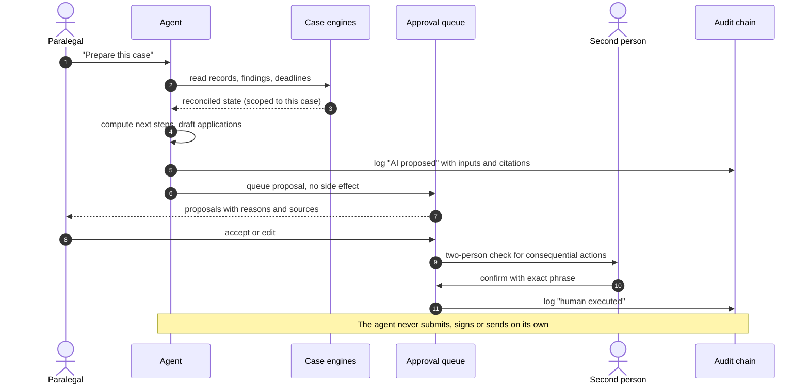
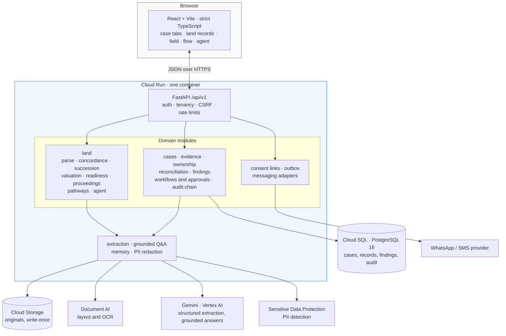

<div align="center">

# 🌾 Groundwork

### Land that families can sell, inherit and borrow against — resolved on the evidence.

**An AI-assisted case platform for land whose records nobody can read: a patta still in a grandfather's name, an FMB sketch that disagrees on the extent, an encumbrance certificate with an open agreement of sale, five heirs of whom two live in the city — and a bank branch that will not look at any of it.**

Built by **[vsrupeshkumar](https://github.com/vsrupeshkumar)** for the **Google Startup Buildathon 2026**


[Problem](#-the-problem) · [Capabilities](#-capabilities) · [Novelty](#-what-is-new) · [Lifecycle](#-a-land-case-end-to-end) · [Architecture](#%EF%B8%8F-architecture) · [Run it](#-run-it-locally) · [Docs](#-documentation)

</div>

---

## 🧭 The problem

For most farming households, land is the main asset — and the least usable one.

- **The record is stale.** Land passes down without formal partition; the record of rights still shows a parent who died years ago, so nobody can sell, divide or pledge it cleanly.
- **The picture is scattered.** The village accountant, the taluk office, the survey office, the Sub-Registrar, the document writer and the lawyer each hold one piece. Families pay to have their own records read back to them.
- **Nobody trusts the value.** Comparable sales are few and under-declared, so banks lend against crops or gold instead, and families turn to moneylenders.
- **Disputes run for years** because records disagree on names, extents and boundaries, and co-heirs who left the village are never asked.

Groundwork prepares the case. **Ownership decisions stay with revenue authorities and courts. Every valuation carries a stated range and a confidence level.**

## 💡 Capabilities

| | Capability | What it means for the family |
|---|---|---|
| 📜 | **Reads the records** | Patta/chitta, adangal, FMB sketch, EC, sale deeds, death and legal heir certificates, read from uploads with the page each fact came from |
| 🔀 | **Concordance matrix** 🆕 | Records laid side by side. Names matched across Tamil, Devanagari, Kannada and six more scripts; extents in cents, guntas, hectare-are, bigha and measured shape; each difference names **the office that corrects it** |
| 🧭 | **Two-way boundary check** 🆕 | If our record puts S.No. 124 to the east, S.No. 124's own record must put us to its west. One-sided boundaries become findings |
| 👪 | **Draft shares through every death** | Exact fractions via the Hindu Succession Act (incl. coparcenary and s.15(2)) and the Indian Succession Act. Muslim law is declined, not guessed |
| 📱 | **Reaches co-heirs who left** | Single-use, expiring links over WhatsApp and SMS in the family's language. An online "yes" is recorded as intent; a signed letter is recorded as consent |
| 🏛️ | **Tracks office files** 🆕 | Legal heir certificate, mutation, EC and survey as dated office events, with objection windows, indicative service timelines, overdue and stalled detection, and drafted escalations up the chain |
| 🛤️ | **Compares the family's options** | Joint mutation, release to the heir who farms it, partition and subdivision, or a collateral-free crop loan now. Each option shows days, fees, stamp duty, signatures and borrowing power per heir |
| 💹 | **Values the land carefully** 🆕 | P10–P50–P90 range with confidence. Guideline-value deeds are treated as floors. Lending value is the P20 less a title haircut |
| 🏦 | **Lender readiness** | Each lender's checklist, what the local branch asks for, and a critical-path fix plan with offices, documents, fees and days |
| 🛂 | **Land credit passport** 🆕 | A two-person-approved, SHA-256-anchored dossier that a branch can verify without seeing any names |
| 🗣️ | **Explains in their language** | The family's own records explained in Tamil, Hindi or English, at no cost |
| 💸 | **Follows the money** | Rupees and days spent, unreceipted payments, excess over official fees, and premiums paid to moneylenders |
| 🔎 | **Learns from the field** | Field questions answered from village visits and from cases, side by side |
| 🤖 | **Propose-only agent** 🆕 | Reads, compares, computes, drafts applications and watches deadlines. Every action is audited as AI. It hands off what only people can do and never executes on its own |

The same platform still handles **US heirs'-property cases** (deeds, wills, tax bills, ownership chain, financial reconciliation). Each case has a *kind*, and a land case gets its own lifecycle, graph and screens.

## 🆕 What is new

Items marked 🆕 are the parts of Groundwork we consider novel. The claims are scoped to what this repository implements.

| # | Novel element | Why it is different | Where it lives |
|---|---|---|---|
| 1 | **Evidence-anchored concordance** | Every difference is a finding bound to a document, a page and the office that can correct it, not a free-text "discrepancy" | `backend/app/domain/land/` (concordance) |
| 2 | **Reciprocal boundary verification** | Boundaries are checked in both directions across neighbouring survey numbers, so a one-sided claim is caught automatically | `backend/app/domain/land/` (concordance) |
| 3 | **Office-aware correction routing** | Each finding is routed to the authority that can fix it, with an indicative timeline and an escalation path | `backend/app/domain/land/` (proceedings, pathways) |
| 4 | **Consent with an evidentiary gradient** | Online intent and signed consent are stored as different legal weights and never merged | `backend/app/domain/land/` (pathways) |
| 5 | **Lending value from a percentile floor** | Valuation uses P10–P50–P90 with guideline values as floors, then P20 minus a title haircut, so the number a bank sees is conservative by construction | `backend/app/domain/land/` (valuation) |
| 6 | **Privacy-preserving land passport** | A SHA-256-anchored dossier verifiable by a branch without revealing names | `backend/app/domain/land/` (readiness) |
| 7 | **Propose-only agent with an audit chain** | The agent can prepare and propose, but a human executes. Each organisation keeps a SHA-256 hash chain that `verify` checks record by record | `backend/app/domain/workflows/`, audit module |
| 8 | **Multilingual record reading** | Names are matched across nine scripts, so transliteration differences stop looking like different people | `backend/app/services/` (extraction) |

## 🚶 A land case, end to end

The case lifecycle is the spine of the product. Each gate is computed from the case's own records and is never ticked by hand.



**How to read it.** Diamonds are gates. A gate opens only when the records satisfy it, so a case cannot move forward on someone's say-so. The dashed loops show that most gates are iterative: a new upload can reopen concordance, and a newly found heir can reopen consent. The purple node is the single hand-off where a person must approve a document that a bank will rely on.

1. **Plot and family.** The paralegal enters the survey number, village, taluk and family tree: who died and when, spouses and children, and who lives away.
2. **Records gathered.** Upload the patta, adangal, FMB sketch and EC. Groundwork reads each one into land records tied to its document and page. Sale deeds of nearby plots become comparable sales.
3. **Records reconciled.** The concordance matrix lays the records side by side. Every difference becomes a finding with the office that corrects it: a deceased holder, a 12.5% extent gap, a one-sided boundary, or an open agreement of sale.
4. **Heirs and shares.** Draft shares are computed through every death. Each step is written in plain words with its assumptions stated.
5. **Co-heir consent.** Consent links go to heirs who left. Signed letters are recorded against their source documents.
6. **Mutation recorded.** The agent drafts the legal heir certificate and mutation applications. Each office file is tracked to its order, and an overdue file gets a drafted escalation.
7. **Lender-ready.** Valuation range, lender checklist and fix plan, or a collateral-free crop loan while title is fixed.
8. **Verified history.** Every action lands on a per-organisation hash chain. Closing a case is a two-person action.

## 🔄 From upload to decision: the evidence pipeline

Evidence moves through one pipeline. Each stage keeps the link back to the original page, so every number on screen can be traced to a document.



**Why this order.** Redaction happens before any model sees text. Normalisation happens before comparison, so the matrix compares like with like. Findings are the only inputs to routing, so an office never receives a vague complaint. Valuation and succession are computed from the same reconciled records, which means they cannot quietly disagree with the concordance.

## 🏛️ Office file lifecycle

Each government file moves through a state machine. The system uses it to detect overdue and stalled files, and to draft the next step.



**How to read it.** `Overdue` is computed from the indicative timeline for that office and file type, not from a fixed date. `Escalated` is reached only through a drafted letter that a person sends. `Contested` leaves the platform's own remit: it is a terminal state for the workflow, and the case continues with counsel.

## 🤝 Co-heir consent, step by step

A co-heir who has left the village can still consent, but the system is strict about what counts as consent.



Intent and consent are never merged. Only signed consent satisfies the mutation gate.

## 🧠 The propose-only agent

The agent is useful because it does the slow work. It is safe because it cannot act on its own.



## 🏗️ Architecture

One deployable, many boundaries. The platform is a modular monolith on Cloud Run, with managed services for storage, extraction and reasoning.



| Layer | Where |
|---|---|
| Rural land engines | `backend/app/domain/land/` |
| Core platform (cases, evidence, findings, approvals, audit) | `backend/app/domain/`, `backend/app/services/` |
| Consent, outbox and messaging | `backend/app/domain/land/`, `backend/app/infrastructure/` |
| Frontend | `frontend/src/features/` (`land`, `cases`, `flow`, …) |
| Infrastructure as code | `infra/` |

**The database is the system of record.** PostgreSQL holds the case state and the audit chain. Cloud Storage holds the originals, which are never overwritten. Gemini and Document AI assist with reading. They never write a finding or a decision on their own.

## 🔐 Security by design

- **Tenant isolation:** another organisation's id returns 404, never 403, so existence is not leaked.
- **Two-person rule:** proposer ≠ approver, exact confirmation phrase, single use, expiry, kill switch.
- **Evidence integrity:** SHA-256 on upload, write-once storage, corrections never overwrite originals.
- **Tamper-evident history:** a per-organisation SHA-256 hash chain. `verify` names the exact broken record.
- **AI guardrails:** case-scoped retrieval, PII redaction before prompts, citations checked, agent proposes but never executes.
- **Narrow public pages:** consent links are single-use, hashed and expiring. Passport verification shows no names.
- **Secrets:** environment-driven configuration; production refuses unsafe settings.

## 🚀 Run it locally

Python 3.12+ and Node 20. Every cloud integration has a local mode.

```bash
cd backend && python -m venv .venv && .venv/bin/pip install -e ".[dev,postgres,gcp]"
.venv/bin/alembic upgrade head && .venv/bin/python -m uvicorn app.main:app --reload --port 8000
```

```bash
cd frontend && npm install && npm run dev        # http://localhost:5173
```

```bash
backend/.venv/bin/python scripts/seed_demo.py    # sign in as pat / demo-password-1
```

Open the **Ramasamy heirs, S.No. 123/4A, Keezhaiyur** case and go to **Land records**. You will see an overdue legal heir certificate, an issued EC, one signed and one online consent, and a co-heir asking for more information. Press **Agent → Prepare this case**.

## 🧪 Tests

```bash
cd backend && .venv/bin/ruff check app tests && .venv/bin/python -m pytest -q
cd ../frontend && npm run build
python scripts/smoke_e2e.py --base-url http://127.0.0.1:8000    # end-to-end smoke
```

## ☁️ Deploy to Google Cloud

```bash
./infra/scripts/bootstrap.ps1 -ProjectId <PROJECT_ID> -CreateBillableResources
gcloud builds submit --config infra/cloudbuild.yaml --substitutions "_INSTANCE=<PROJECT_ID>:us-central1:groundwork-pg,SHORT_SHA=$(git rev-parse --short HEAD)"
```

Cloud Build runs lint, backend tests and the frontend build before deploying to Cloud Run. Runbook: [gcp-runbook.md](docs/deployment/gcp-runbook.md).

## 📚 Documentation

| Doc | About |
|---|---|
| [`docs/land/rural-india.md`](docs/land/rural-india.md) | Rural land records: the brief, the workflow and the field questions mapped to features |
| [`docs/architecture/overview.md`](docs/architecture/overview.md) | Modules and boundaries |
| [`docs/workflows/case-lifecycle.md`](docs/workflows/case-lifecycle.md) | The heirs'-property case lifecycle |
| [`docs/security/model.md`](docs/security/model.md) | Threat model and controls |
| [`docs/deployment/gcp-runbook.md`](docs/deployment/gcp-runbook.md) | Google Cloud deployment |

---

<div align="center">

**Groundwork** · built by [vsrupeshkumar](https://github.com/vsrupeshkumar) for the **Google Startup Buildathon 2026**

*Every fact traced to a page. Every decision made by a person. Every step on the record.*

</div>
