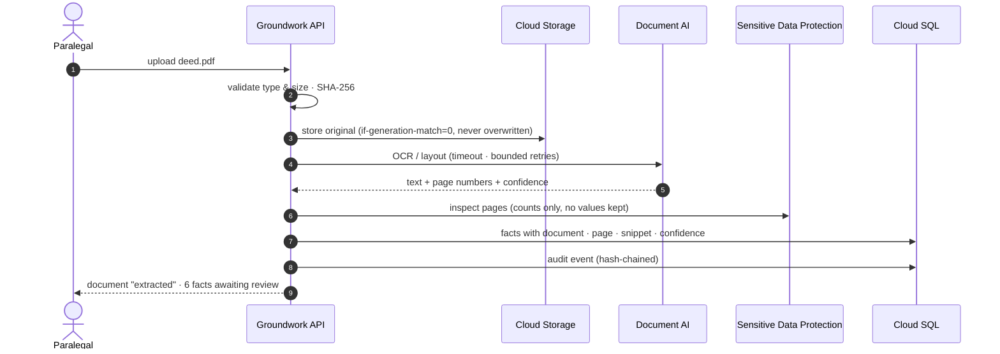
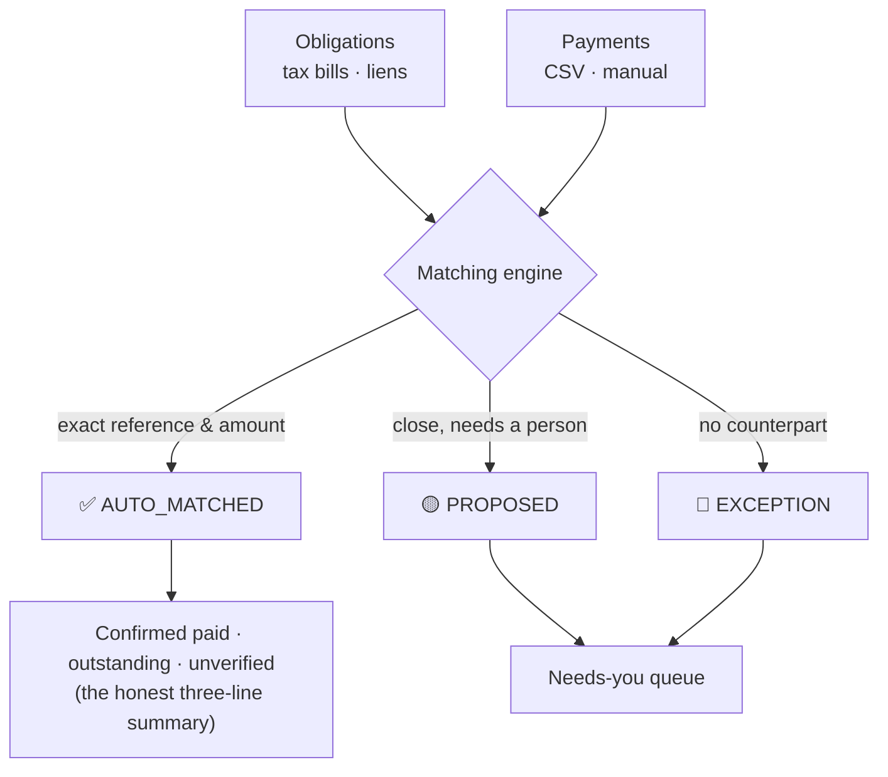
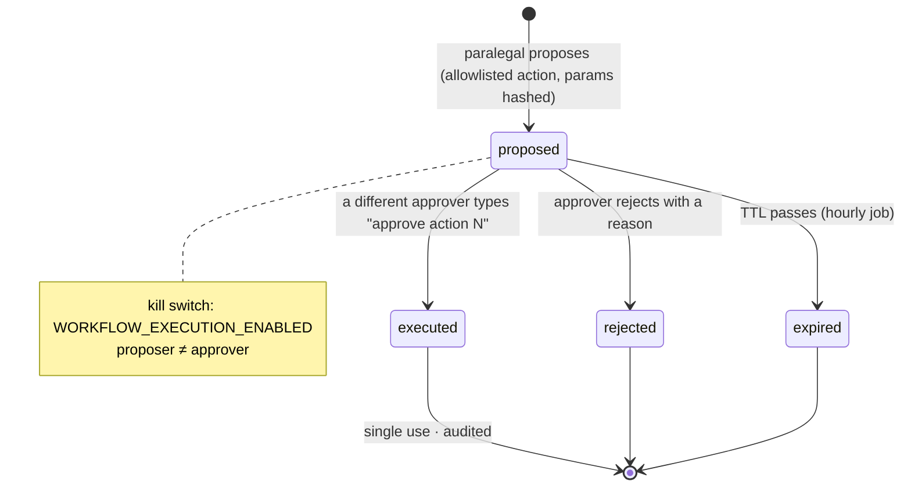
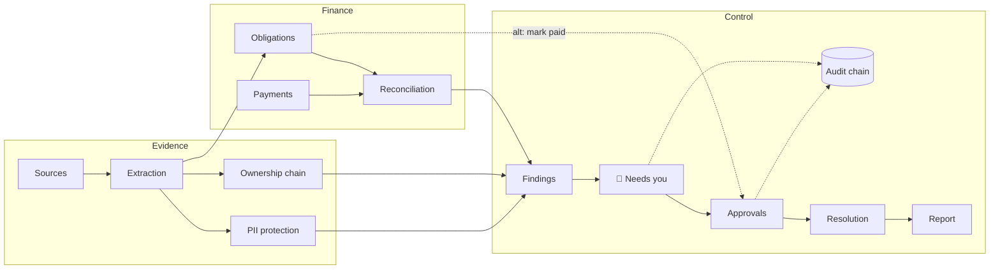
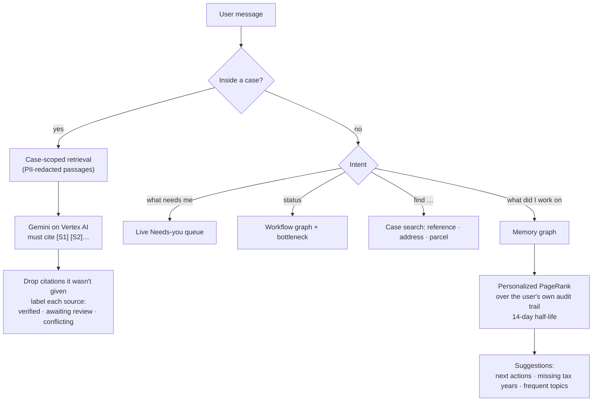
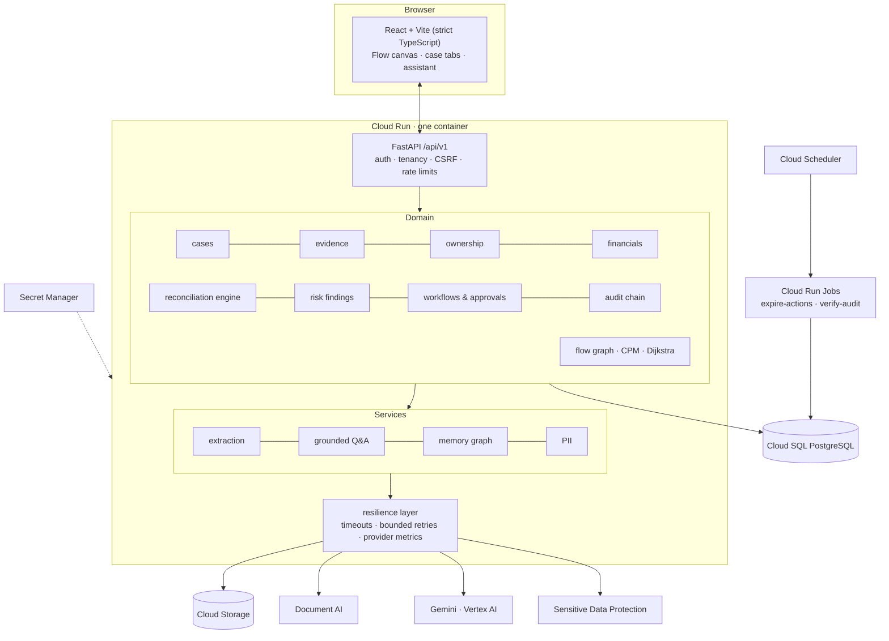
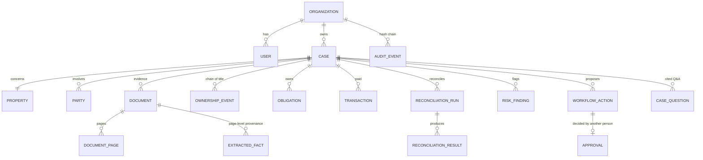
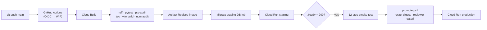

<div align="center">

# 🏡 Groundwork

### Inherited property, resolved on the evidence.

**An AI-assisted case platform that turns a pile of deeds, death certificates, wills and tax bills into a verified ownership chain, a reconciled financial picture, and a tamper-evident record of every human decision.**

Built by **[vsrupeshkumar](https://github.com/vsrupeshkumar)** for the **Google Startup Buildathon 2026**


[The problem](#-the-problem) · [What it does](#-what-groundwork-does) · [How it works](#-how-it-works-step-by-step) · [Architecture](#%EF%B8%8F-architecture) · [Google Cloud](#%EF%B8%8F-built-on-google-cloud) · [Run it](#-run-it-locally) · [Deploy](#-deploy-to-google-cloud)

</div>

---

## 🧭 The problem

When a homeowner dies without a clear estate plan, the house often passes informally to heirs for generations. This is called **heirs' property**. The family lives there, but on paper the title is broken:

- the last recorded owner died decades ago,
- deeds, wills and death certificates are scattered across county offices and shoeboxes,
- property taxes, water liens and partial payments pile up without anyone matching them to the right bill,
- and families lose homes to tax sales, fraud, or predatory "quiet title" buyers because nobody can prove the chain.

Legal-aid organisations resolve these cases by hand. One case can mean hundreds of pages of evidence, a ledger of payments, and months of paralegal time. Every conclusion has to trace back to a document and a page, because it may end up in front of a judge.

## 💡 What Groundwork does

Groundwork gives a legal-aid team **one case file** that connects everything, and lets software do the tedious parts while people make every consequential decision.

| | Capability | What it means for the team |
|---|---|---|
| 📄 | **Evidence ingestion** | Upload deeds, wills, death certificates, tax bills. Originals are stored privately, fingerprinted with SHA-256 and never overwritten. |
| 🔍 | **Extraction with provenance** | Document AI reads every page; facts (grantor, grantee, parcel, dates, amounts) are extracted **with the document and page they came from**. |
| ✅ | **Human review** | Every extracted fact is confirmed, corrected or rejected by a person. Corrections keep the original. |
| 🛡️ | **PII protection** | Sensitive Data Protection finds SSNs, account numbers, emails. Only counts are stored, and text is de-identified before it reaches the AI. |
| 🔗 | **Ownership reconstruction** | Rebuilds the chain of title from reviewed facts and flags gaps, deceased owners and transfers by people who did not own the property. |
| 💰 | **Financial reconciliation** | Matches tax bills and liens to payments with a deterministic, tiered matching engine: auto-matched, proposed, or exception. |
| 🚩 | **Discrepancy findings** | Parcel mismatches, unprobated wills, broken chains, unpaid years. Each finding has an explanation and evidence links. |
| 🗺️ | **Live workflow graph** | One canvas showing every stage of every case, computed live, with the **critical path** and **next best action**. |
| 🙋 | **"Needs you" queue** | Every question waiting on a human, ranked by severity, money involved and how long it has waited. |
| 💬 | **Grounded assistant** | Ask about a case; Gemini answers **only from that case's evidence**, with citations and each source's review status. |
| 🧠 | **Context-graph memory** | Learns what each user works on (from their own audit trail) to rank suggestions, without storing anything new. |
| ✍️ | **Two-person approvals** | Consequential actions need a different person to type an exact confirmation phrase. Single-use, expiring, with a kill switch. |
| ⛓️ | **Tamper-evident history** | Every action is written to a SHA-256 hash chain per organisation; any edited or deleted record breaks the chain at a named point. |
| 🏢 | **Multi-tenant isolation** | Organisations can never see each other's cases, documents or records, even by guessing IDs. |

> **Groundwork does not make legal determinations, file documents, or move money.** It organises evidence and surfaces findings for professional review.

## 🌾 Rural land records (India)

The same evidence-first approach, applied to **farm land that is too unclear to sell, inherit or borrow against**: a patta that still shows a grandfather who died in 1987, an FMB sketch that disagrees on the extent, an EC with an open agreement of sale, five heirs of whom two live in the city, and a bank branch that will not look at any of it.

| | Capability | What it does |
|---|---|---|
| 📜 | **Record reading** | Patta/chitta, adangal, FMB, EC, sale deeds, death and legal heir certificates read from uploads, with page provenance |
| 🔀 | **Record concordance** | Names (across Tamil, Devanagari, Kannada and six more scripts), extents (cents, guntas, hectare-are, bigha, shoelace area), survey subdivisions, land class and boundaries compared side by side — each disagreement names **the office that corrects it** |
| 🧭 | **Boundary reciprocity** | If our record puts S.No. 124 to the east, S.No. 124's record must put us to its west |
| 👪 | **Succession engine** | Exact draft shares through every death since the record was last changed (Hindu Succession Act incl. s.6 coparcenary, s.15(2); Indian Succession Act). Muslim law is declined, not guessed |
| 📱 | **Co-heir consent links** | Single-use, hashed, expiring links: a co-heir who left the village sees their share and replies from a phone |
| 💹 | **Conservative valuation** | P10–P50–P90 with confidence; Bayesian shrinkage to the guideline value; guideline-value deeds treated as floors; lending value = P20 less a title haircut |
| 🏦 | **Lender readiness** | Each lender's checklist, the RBI collateral-free limit first, a critical-path fix plan with offices, documents, fees and days; local branch asks from field visits |
| 🛂 | **Land credit passport** | Two-person-approved, SHA-256-anchored dossier a branch can verify publicly without seeing names |
| 🗣️ | **Explained in Tamil / Hindi** | The family's own records explained in their language, for free |
| 💸 | **Following the money** | Rupees and days spent, unreceipted payments, excess over official fees, and the premium paid to moneylenders |
| 🔎 | **Field research** | The six field questions answered from field visits *and* from the organisation's cases, side by side |
| 🧭 | **Land lifecycle** | Its own stages — plot, records, reconciled, heirs, consent, mutation, lender-ready — gated on the case's records, with its own Flow graph and Needs-you items |
| 🏛️ | **Office proceedings** | Legal heir certificate, mutation, EC, survey, appeal, mediation tracked as the office processes them: dated events, objection windows, indicative service timelines, overdue/stalled detection, and drafted escalations up the chain |
| 🛤️ | **Family pathways** | Joint mutation vs. release to the farming heir vs. partition vs. a collateral-free bridge loan — days, fees, stamp duty, signatures, and borrowing power per heir, side by side |
| 🤖 | **Land case agent** | Plans and runs all of the above, drafts the office applications, watches their timelines, audited as AI; hands off what only people and offices can do; proposes, never executes |

Details, and how every line of the brief maps to code: [`docs/land/rural-india.md`](docs/land/rural-india.md).

## 🤝 Multi-party approvals on Canton Network

Some decisions belong to **another institution**. Groundwork sends an ownership-resolution proposal to the land
registry as a DAML contract on Canton: the legal-aid organisation and the registry each run their own participant
node and party, only the registry can decide (Canton refuses anything else), a decision consumes the request, and
each side reads the committed decision from its own participant. Only opaque ids, salted evidence commitments and
decision codes go on the ledger; the registry recomputes the commitment from the evidence shared off-ledger before
it may approve. Groundwork's two-person rule still applies before anything is sent.

Verified on a real two-participant Canton 3.4 LocalNet (contracts, failure modes and the CASE-101 end-to-end run).
DevNet and TestNet are prepared but **not yet deployed** (they need allowlisting and a sponsor) — see
[`docs/canton`](docs/canton/architecture.md).

---

## 🚶 How it works, step by step

One case moves through eight stages. Each stage's checklist is computed from the case's own records, never ticked by hand.

```mermaid
flowchart LR
    A["1 · Intake<br/>property + parties"] --> B["2 · Evidence<br/>upload + extract"]
    B --> C["3 · Ownership<br/>rebuild chain of title"]
    C --> D["4 · Financial<br/>reconcile taxes & liens"]
    D --> E["5 · Discrepancies<br/>detect findings"]
    E --> F["6 · Human review<br/>confirm · correct · dismiss"]
    F --> G["7 · Resolution<br/>approved actions"]
    G --> H["8 · Verified history<br/>hash-chained record"]
    style A fill:#ffffeb,stroke:#1a1a1a
    style H fill:#034f46,color:#fff,stroke:#034f46
```



### Step 1 · Open a case
A paralegal records the property (address, county, parcel number) and the people involved: the client, heirs, and the deceased owners.

### Step 2 · Upload the evidence
Documents are checked (type, size), fingerprinted, and stored privately in Cloud Storage under a write-once key. **Document AI** extracts the text page by page. Rules (and optionally Gemini, through a grounding gate) pull out structured facts, each one tied to its document, page and snippet.



### Step 3 · Review the facts
Nothing the machine extracted becomes "true" until a person confirms or corrects it. The original value is always preserved next to the correction.

### Step 4 · Rebuild the ownership chain
Groundwork walks the reviewed deeds, quitclaims, wills and death records in date order and reports what does not connect: a grantor who never owned the property, a decades-long gap, an owner who died before transferring.

### Step 5 · Reconcile the money
Tax bills and liens become obligations; payments are imported from CSV or entered by hand. The reconciliation engine (ported from our Magpie codebase, and unchanged) matches them in tiers, from exact reference matches to tolerance-based proposals, and works in integer cents only:



### Step 6 · Detect and review findings
Rules compare everything to everything: parcel numbers across documents, owners against death records, wills against probate, tax years against payments. Every finding carries a severity, an explanation, a confidence level, and links to the exact evidence.

### Step 7 · Approve consequential actions
Resolving a case, dismissing a finding, or recording an obligation as paid is a **proposal**, not an action. It executes only after a *different*, qualified person types the exact phrase, such as `approve action 3`.



### Step 8 · A history nobody can quietly edit
Every upload, review, question, proposal and decision is appended to a per-organisation hash chain. `verify` names the exact record where the chain breaks if anyone tampers with the database. A scheduled job re-verifies it every night.

---

## 🗺️ The live workflow graph

The **Flow** page (and the Flow tab on every case) shows the whole pipeline as one graph. **Every number on it is counted from the database on each request** and refreshes every 10 seconds.



Two classic scheduling algorithms run over this graph, with each node weighted by the work it still has outstanding:

| Algorithm | What it answers |
|---|---|
| **Critical Path Method** (Kelley & Walker, 1959) | *What is actually holding this case back?* The longest chain of remaining work to resolution; its first unfinished node becomes **Next best action**. |
| **Dijkstra's shortest path** (1959) | *What is the least-effort route to resolution?* It takes alternatives into account, such as settling an obligation by an approved "mark paid" action instead of a full reconciliation. |
| **Weighted priority** | *What should I do first?* Needs-you items are ranked by `severity × (1 + log₁₀(1 + amount/$1,000)) × age factor`. |

## 💬 The grounded assistant and memory

A chat panel on the right (a bottom sheet on phones) answers from live data only.



Answers are structured as **Verified evidence · Awaiting review · Conflicts · Missing · Interpretation**, so an AI-generated sentence can never pass as a verified ownership fact. Without Gemini configured, the assistant returns the most relevant passages instead of inventing an answer.

---

## 🏗️ Architecture

Groundwork merged three earlier codebases (**InHeir**: property and legal-document intelligence; **Magpie**: financial reconciliation; **Beacon**: frontend and approval workflow) into **one modular monolith**: one backend, one frontend, one database, one `/api/v1`.



### Data model at a glance



### Repository layout

```
Groundwork/
├── frontend/              React + Vite, strict TypeScript (the only frontend)
│   └── src/features/      cases · evidence · ownership · financials · findings · flow · approvals · audit
├── backend/               FastAPI modular monolith (the only backend)
│   ├── app/api/v1/        one versioned API
│   ├── app/domain/        cases · evidence · ownership · reconciliation · risk · workflows · audit · flow
│   ├── app/services/      extraction · rag · memory · pii · search · reporting
│   ├── app/infrastructure/google_cloud/   storage · documentai · gemini · dlp adapters
│   ├── migrations/        Alembic (forward-only)
│   ├── tests/             unit · integration · contract
│   └── live_tests/        opt-in tests against real Google Cloud services
├── infra/                 Cloud Build · Cloud Run manifest · PowerShell bootstrap/promote · monitoring
├── scripts/               demo seeder · 12-step end-to-end smoke test
├── docs/                  architecture · security · workflows · deployment runbook · budget
└── Dockerfile             one image: built frontend served by the backend
```

---

## ☁️ Built on Google Cloud

| Need | Google Cloud service | How Groundwork uses it |
|---|---|---|
| Hosting | **Cloud Run** | One container (API + frontend), scales to zero, `/ready` startup probe, graceful shutdown |
| Database | **Cloud SQL for PostgreSQL** | Unix-socket connector, bounded pool, statement timeouts, daily backups + PITR |
| Evidence | **Cloud Storage** | Private bucket, uniform access, public-access prevention, write-once keys, SHA-256 verified reads |
| OCR | **Document AI** | Page-level text and confidence; size and page limits checked before sending |
| AI | **Gemini on Vertex AI** | Grounded, cited answers; service-account auth, no API keys |
| Privacy | **Sensitive Data Protection** | Inspects documents (counts only), de-identifies text sent to the model |
| Secrets | **Secret Manager** | JWT key, database URL, webhook key, processor id |
| Delivery | **Artifact Registry + Cloud Build** | Lint → tests → audits → build → migrate → deploy staging → health check |
| Identity | **Workload Identity Federation** | GitHub Actions deploys without any JSON key |
| Operations | **Cloud Logging · Monitoring · Scheduler · Run Jobs** | JSON logs with request/trace IDs, alert policies, hourly/nightly jobs |



---

## 🔐 Security by design

- **Tenant isolation**: every record lookup joins back to the caller's organisation; another tenant's ID returns 404, never 403.
- **Two-person rule**: proposer ≠ approver, exact confirmation phrase, parameters pinned by hash, single use, expiry, global kill switch.
- **Evidence integrity**: SHA-256 on upload, write-once storage, hash-checked downloads, corrections never overwrite originals.
- **AI guardrails**: case-scoped retrieval, PII redaction before prompts, invented citations dropped, unsupported answers marked *unverified*.
- **Sessions**: bcrypt passwords, HttpOnly secure cookies, CSRF header check, rate-limited sign-in, strict CSP and security headers.
- **No secrets in code**: Secret Manager plus Workload Identity; production refuses to start on default secrets, SQLite, local storage or wildcard CORS.
- **Logs without PII**: identifiers and timings only; emails, SSNs and tokens are scrubbed from every log line.

---

## 🚀 Run it locally

Requirements: Python 3.12+ and Node 20+. No cloud account needed: every integration has a local mode.

```powershell
# backend
cd backend
python -m venv .venv
.venv\Scripts\pip install -e ".[dev,postgres,gcp]"
.venv\Scripts\alembic upgrade head
.venv\Scripts\python -m uvicorn app.main:app --reload --port 8000

# frontend (second terminal)
cd frontend
npm install
npm run dev                     # http://localhost:5173

# demo data (third terminal, repo root)
backend\.venv\Scripts\python scripts\seed_demo.py     # users avery / pat / alex · password demo-password-1
```

Then open **Flow**, pick a case, review a few facts, and ask the assistant *"what needs me?"*.

## 🧪 Tests

```powershell
cd backend
.venv\Scripts\ruff check app tests
.venv\Scripts\python -m pytest -q                      # unit + integration + contract (SQLite)
$env:GROUNDWORK_TEST_DATABASE_URL = "postgresql+psycopg://user:pw@localhost:5432/groundwork_test"
.venv\Scripts\python -m pytest -q                      # same suite on PostgreSQL
$env:GROUNDWORK_LIVE = "1"; .venv\Scripts\python -m pytest live_tests -v   # real Google Cloud (opt-in)
cd ..\frontend; npm run build                          # strict tsc + production build

# the 12-step synthetic case against any running instance
backend\.venv\Scripts\python scripts\smoke_e2e.py --base-url http://127.0.0.1:8000
```

The smoke test runs one synthetic heirs'-property case end to end: sign-in, property, upload, extraction, PII, ownership, reconciliation, findings, AI question, reject + approve, audit-chain verification, and a cross-tenant attack. It labels each step **live** or **local** from what the server actually reports.

## ☁️ Deploy to Google Cloud

```powershell
gcloud auth login
.\infra\scripts\bootstrap.ps1 -ProjectId <PROJECT_ID>                                         # inspect only
.\infra\scripts\bootstrap.ps1 -ProjectId <PROJECT_ID> -GitHubRepo Ground-work-gcp/Groundwork -CreateBillableResources
gcloud builds submit --config infra/cloudbuild.yaml --substitutions "_INSTANCE=<PROJECT_ID>:us-central1:groundwork-pg,SHORT_SHA=$(git rev-parse --short HEAD)"
```

The full runbook is in [`docs/deployment/gcp-runbook.md`](docs/deployment/gcp-runbook.md), and the cost plan for a $300 credit (about $15–30/month at pilot scale) is in [`docs/deployment/budget-300.md`](docs/deployment/budget-300.md).

## 📚 Documentation

| Doc | About |
|---|---|
| [`docs/architecture/overview.md`](docs/architecture/overview.md) | Modules and boundaries |
| [`docs/workflows/case-lifecycle.md`](docs/workflows/case-lifecycle.md) | The eight stages in detail |
| [`docs/security/model.md`](docs/security/model.md) | Threat model and controls |
| [`docs/canton/architecture.md`](docs/canton/architecture.md) | Canton multi-party approvals: architecture, LocalNet, DevNet, TestNet, security, troubleshooting |
| [`docs/land/rural-india.md`](docs/land/rural-india.md) | Rural land records (India): the brief, mapped to features |
| [`docs/migration/inventory.md`](docs/migration/inventory.md) | What came from InHeir, Magpie and Beacon |
| [`infra/monitoring/alert-policies.md`](infra/monitoring/alert-policies.md) | What to alert on and the log queries |

---

<div align="center">

**Groundwork** · built by [vsrupeshkumar](https://github.com/vsrupeshkumar) for the **Google Startup Buildathon 2026**

*Every fact traced to a page. Every decision made by a person. Every step on the record.*

</div>
